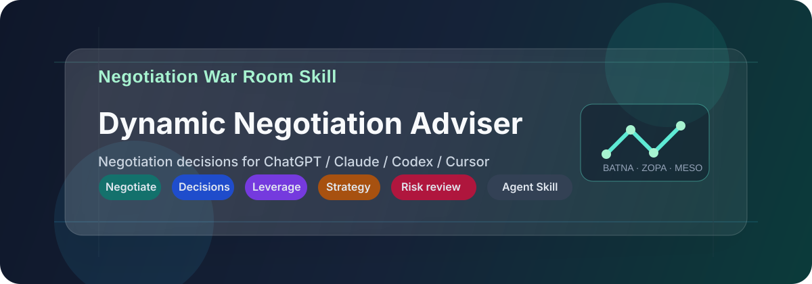
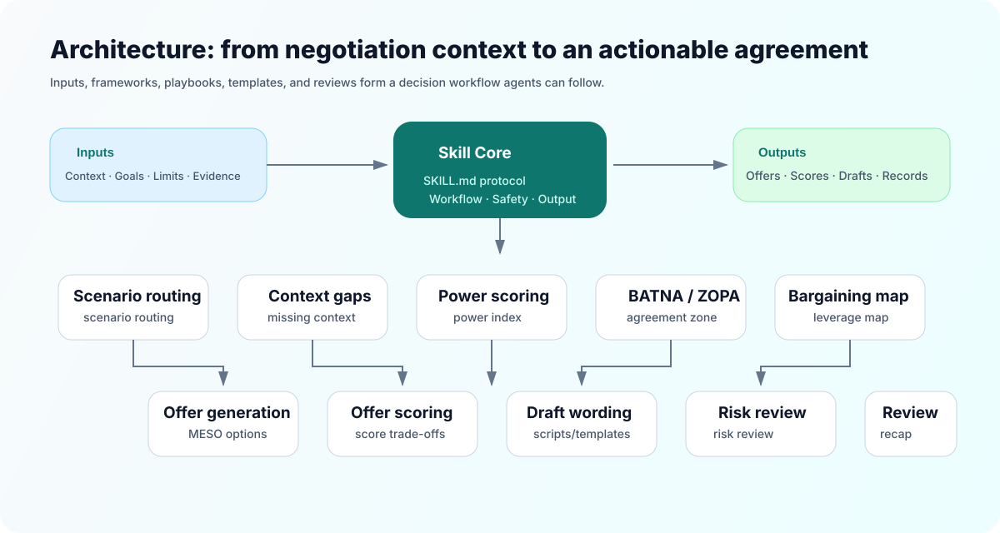
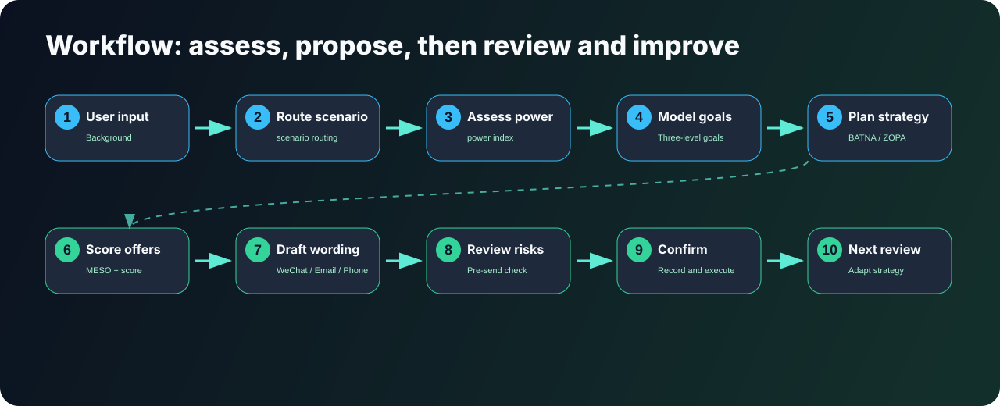

# negotiation-war-room-skill

**Negotiation War Room Skill**, a dynamic negotiation adviser.

English translation of [coinluu/negotiation-war-room-skill](https://github.com/coinluu/negotiation-war-room-skill). This fork translates the full bundle, including prompts, frameworks, playbooks, templates, examples, tests, documentation, and diagrams. The original methods, examples, amounts, and scoring models are retained. The core entry point is `SKILL.md`.

## Overview

A negotiation decision skill for ChatGPT, Claude, Cursor, Codex, and other agents. Turn complex background into structured strategy, alternatives, communication drafts, risk reviews, and next-round actions.

## Why use it?

Negotiations often stall because key questions remain unanswered: what kind of negotiation is this, what alternatives exist, what pressures affect the other party, which concessions can be exchanged, and which limits should stay private?

This skill makes those judgments part of an agent workflow, supporting preparation, reusable communication, and improvement through review.

## Purpose

The skill diagnoses the scenario and information gaps, assesses power, BATNA / ZOPA, bargaining assets, and risk boundaries, then generates offers, scores, wording, confirmations, and next-round recommendations.

It aims to improve preparation and the likelihood of a better agreement that can be carried out. It does not guarantee success.

## Capabilities

- Scenario identification: discounts, payments, compensation, contracts, friends, family, and more.
- Power scoring: alternatives, time pressure, information, resource control, evidence, relationship dependence.
- BATNA / ZOPA: alternatives without agreement and the possible agreement range.
- Bargaining map: price, time, scope, payment, risk, resources, relationships, information, options.
- Conditional concessions: secure definite conditions in return.
- MESO offers: two or three acceptable offers with different combinations of terms.
- Offer scoring: value, agreement likelihood, risk, relationships, execution clarity.
- Wording: natural drafts for WeChat, phone, in person, email, and meetings.
- Rehearsal: simulate the other party's responses.
- Risk review: check exposed limits, emotional wording, legal risk, free concessions, and records.
- Confirmation: reusable minutes and chat or email confirmations.
- Reassessment: update strategy from new feedback across rounds.

## Architecture



## Workflow



## Scenarios

| Scenario | Typical issues |
|---|---|
| Business cooperation | Model, scope, payments, resource exchanges |
| Client discounts | Price objections, cheaper competitors, renewal cuts |
| Outstanding payments | Delivered work, delayed payment or acceptance, canceled future service |
| Compensation | Offers, raises, bonuses, level, review dates |
| Contracts | Payment, acceptance, breach, caps, scope |
| Procurement and sales | Unit price, payment terms, minimum orders, quality, supply |
| Partners | Equity, roles, contributions, decisions, exits |
| Disputes | Refunds, compensation, responsibility, complaints, settlements |
| Friends and relatives | Joint projects, loans, free help, social pressure |
| Family | Financial boundaries, responsibilities, relationship conflict |

## Excluded uses

Do not use this project for threats, intimidation, extortion, fabricated evidence, malicious manipulation, unlawful pressure, impersonation of lawyers or third parties, private-information exposure, humiliation, retaliation, or harassment.

It does not promise certain agreement, recovery, or litigation success. For contract, employment arbitration, litigation, compensation, family property, or physical safety risks, it provides communication strategy, evidence organization, and risk considerations rather than professional representation.

## Quick start

Use the repository as an agent skill library:

```text
Use negotiation-war-room-skill.
Read SKILL.md, then load relevant frameworks, playbooks, and templates for my scenario.

My negotiation background:
[paste background]

Provide a situation assessment, information gaps, power index, BATNA/ZOPA, three offers, scores, first-round wording, risk review, and confirmation.
```

For tools accepting system instructions:

- [SKILL.md](SKILL.md): full core protocol.
- [System prompt](prompts/system-prompt.md): standalone agent instructions.

Suitable for ChatGPT, Claude, Cursor, Codex, OpenAI agents, and custom workflows.

## Usage options

### 1. Copy `SKILL.md` into the agent

For the complete workflow:

```text
Read this skill protocol and follow its workflow:
[paste SKILL.md]

My background:
[paste background]
```

### 2. Use the system prompt

For custom GPTs, Claude Projects, Cursor Rules, and agent system instructions:

```text
System instructions:
[paste prompts/system-prompt.md]

User input:
[complete input-template.md]
```

### 3. Choose a playbook

For a particular negotiation:

- [Client discount](playbooks/client-discount.md)
- [Outstanding payment](playbooks/business-payment.md)
- [Compensation](playbooks/salary-negotiation.md)
- [Contract](playbooks/contract-negotiation.md)
- [Family and relationships](playbooks/relationship-communication.md)

## Standard input

```text
[Negotiation type]
Business cooperation / discount / payment / compensation / contract / procurement and sales / partners / dispute / friends / family / other

[Background]
What happened, and where do talks stand?

[My role and authority]
Decision-maker, implementer, provider, client, employee, candidate, partner, or another role?

[Other party's role and authority]
Who are they, and do they have final authority?

[My objective]
What outcome do I want?

[My walk-away limit]
What is the minimum acceptable result?

[My BATNA]
What alternatives exist if no agreement is reached?

[Other party's possible interests]
What might matter most to them?

[My bargaining assets]
Value, evidence, resources, alternatives, timing advantages?

[My weaknesses]
Concerns and vulnerabilities?

[Evidence]
Chats, contracts, payments, deliverables, minutes, etc.

[Channel]
WeChat / phone / in person / email / meeting / other

[Style]
Gentle / measured / firm boundaries / formal / tactful / preserve goodwill / close quickly

[Requested output]
Strategy / wording / rehearsal / editing / risk review / confirmation
```

See the [full input template](prompts/input-template.md).

## Example prompts

### Outstanding payment

```text
Use negotiation-war-room-skill.

We verbally agreed RMB 30,000; RMB 6,000 is paid. I completed an account assessment, topic plan, and two coaching sessions. The client no longer needs future service and may resist the balance. No formal contract, but chats, transfers, and files exist.

Provide assessment, gaps, power, BATNA/ZOPA, three settlements, WeChat wording, risk review, and confirmation.
```

### Client discount

```text
Use negotiation-war-room-skill.

I quoted RMB 100,000 for annual service; the client cites RMB 60,000 and requests 40% off. I can discount only 10%, with reduced scope required below RMB 90,000. The existing client values results but has a tight budget.

Protect value, design different offers, and draft a WeChat reply.
```

### Compensation

```text
Use negotiation-war-room-skill.

My PM offer from an AI SaaS company is 32k × 14. I want 38k × 14 and have another 35k × 14 offer. The role includes monetization and growth, where I have relevant results.

Analyze bargaining assets, market value, BATNA/ZOPA, then draft an HR email and replies to likely reactions.
```

### Partners

```text
Use negotiation-war-room-skill.

A friend and I want a local business review account. He brings merchant resources; I handle content, filming, editing, and operations. He wants 50/50, but equity, roles, contributions, account ownership, and exits are unclear.

Provide meeting strategy, three options, first wording, and confirmation.
```

### Contract

```text
Use negotiation-war-room-skill.

Payment depends on client satisfaction without specific acceptance criteria. Liability is heavy and uncapped. I worry about the balance and responsibility.

Assess clause risks, propose negotiation changes, and draft a formal email.
```

See [20 more prompts](docs/prompt-examples.md) and [worked examples](examples/).

## Example output structure

```text
1. Current situation
2. Power index for both sides
3. Information gaps
4. Three-level goal model
5. BATNA / ZOPA
6. Bargaining map
7. Other party's profile
8. Strategy
9. Three offers
10. Scores
11. First-round wording
12. Likely reactions and replies
13. Pre-send risk review
14. Confirmation
15. Next-round actions
```

See the [full output template](prompts/output-template.md).

## Documentation

- [Quick start](docs/quick-start.md): clone, prompts, input, and output checks.
- [Use cases](docs/use-cases.md): payments, discounts, compensation, contracts, partners, disputes, friends, family.
- [Agent integration](docs/agent-integration.md): platform usage.
- [Prompt examples](docs/prompt-examples.md): 20 scenarios.
- [Safety boundaries](docs/safety-boundaries.md): exclusions, high-risk requests, professional advice.
- [Methodology](docs/negotiation-methodology.md): BATNA, ZOPA, power, MESO, concessions.
- [FAQ](docs/faq.md)
- [Roadmap](docs/roadmap.md)

## Repository structure

```text
negotiation-war-room-skill/
├── SKILL.md                 # Core protocol and agent entry point
├── prompts/                 # System, input, output, simulation, and review prompts
├── frameworks/              # BATNA, ZOPA, power, concessions, MESO, risk
├── playbooks/               # Scenario-specific approaches
├── templates/               # WeChat, email, phone, meetings, confirmation, follow-up
├── examples/                # Complete input-to-output cases
├── tests/                   # Prompts, edge cases, acceptance checklist
├── docs/                    # Usage, scenarios, roadmap, example prompts
├── CONTRIBUTING.md          # Contribution guidance
├── SECURITY.md              # Safety policy
├── CHANGELOG.md              # Version history
└── LICENSE
```

## Setup

No build or dependency installation is required.

### 1. Clone this English fork

```bash
git clone https://github.com/guillem-gelabert/negotiation-war-room-skill.git
cd negotiation-war-room-skill
```

### 2. Read the core protocol

```bash
cat SKILL.md
```

### 3. Copy system instructions

```bash
cat prompts/system-prompt.md
```

Paste them into your agent's System Prompt, Rules, or Instructions.

### 4. Check a test prompt

Choose one from [tests/test-prompts.md](tests/test-prompts.md). Check for scenario assessment, gaps, power, BATNA/ZOPA, three offers, scores, first wording, risk review, and confirmation.

## Roadmap

- [ ] More industries: design, consulting, outsourced e-commerce, enterprise software, renovation.
- [ ] More wording templates across firmness, relationships, and channels.
- [ ] More success, failure, and debrief cases.
- [ ] Multi-round review templates tracking feedback, strategy changes, and next actions.
- [x] English README, system prompt, core templates, and supporting materials in this fork.

See the [full roadmap](docs/roadmap.md).

## Contributing

Contribute scenarios, wording, successful or failed cases, industry playbooks, test prompts, and safety improvements. Read [CONTRIBUTING.md](CONTRIBUTING.md) and remove names, phone numbers, addresses, contract numbers, company secrets, and unauthorized chat records.

## Support

If the project helps your preparation or agent workflow, consider starring the [original repository](https://github.com/coinluu/negotiation-war-room-skill) to help others find it.

## License

[MIT](LICENSE). Original attribution is preserved.
